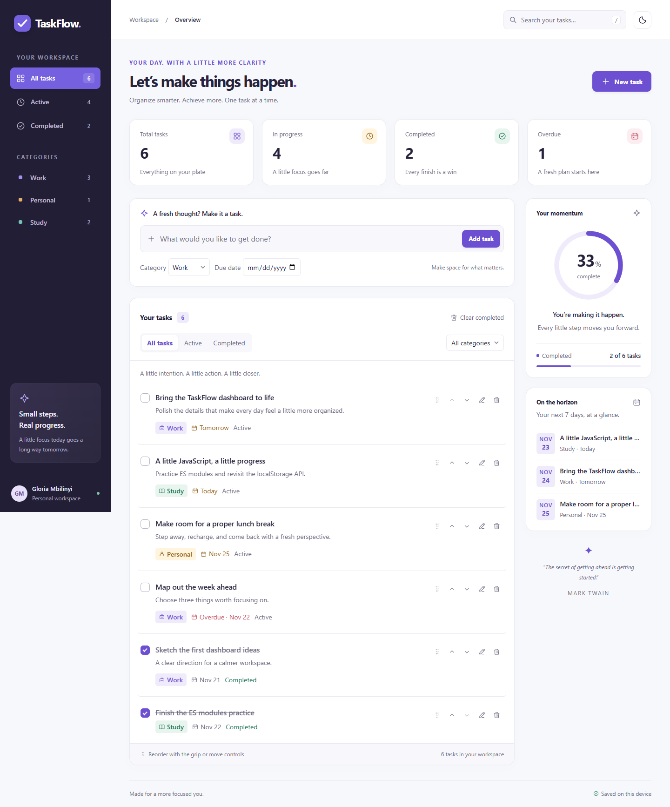
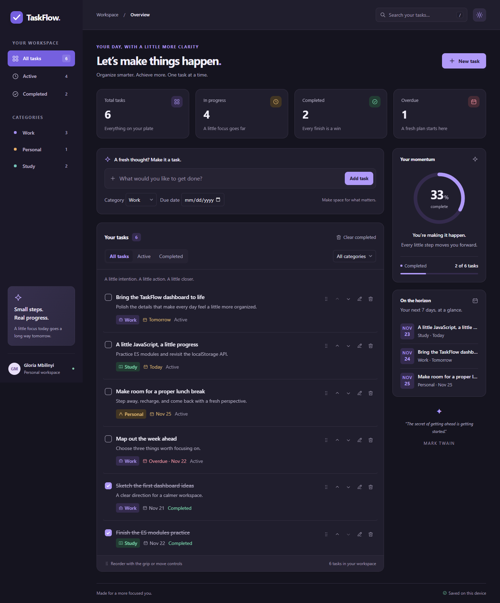
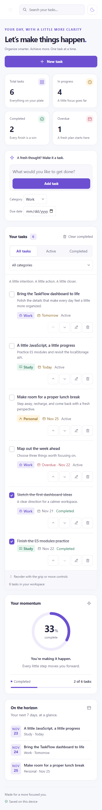

# TaskFlow — Smart Task Manager

**Organize smarter. Achieve more.**

A responsive, browser-local task workspace built with semantic HTML, modern CSS, and vanilla JavaScript modules. Full CRUD, combined filters, and meaningful progress help turn a scattered to-do list into a clear plan. No account or backend is needed.

**Datheon Full Stack Web Development Internship · Task 2 — Dynamic Task Manager (CRUD Application)**

[Repository](https://github.com/gloria-mbilinyi/taskflow-datheon) · [Developer](https://github.com/gloria-mbilinyi)



## The problem

Tasks are easy to write down and easy to lose track of. TaskFlow keeps the next step visible: group tasks by Work, Personal, or Study, set realistic due dates, and watch progress grow in a calm, accessible workspace.

## Features

- Create tasks with a title, optional description, category, and optional due date.
- Edit every task field, including completion. IDs and creation times stay intact; edits update the modification timestamp.
- Complete and reopen tasks with clear status labels and a reduced-motion-aware animation.
- Delete individual tasks or clear all completed tasks after explicit confirmation.
- Combine All / Active / Completed views, categories, and instant search. Search matches titles, descriptions, and categories and ignores case and accents.
- Reorder using native desktop drag-and-drop or labeled move-up/move-down buttons for keyboard and mobile. Order persists immediately.
- See total, active, completed, and overdue counts, completion progress, and the next three tasks due within seven days.
- Recognize overdue, today, and tomorrow dates using the local calendar. Completed tasks are never counted as overdue.
- Persist light/dark theme choices; otherwise follow the system preference.
- Use collapsible mobile navigation, native modal dialogs with focus management, visible focus indicators, screen-reader announcements, and toast notifications.
- Continue in memory when storage is blocked or full, with a persistent warning, backup download, and confirmed recovery.
- Protect corrupted/partially invalid saved data from automatic overwrites and receive valid updates from other tabs.

The app starts empty. Screenshot examples are entered through the real forms by the screenshot script; visitors receive no seeded tasks.

## Technologies

| Layer | Implementation |
| --- | --- |
| Structure | HTML5 landmarks, forms, lists, native `dialog`, SVG icons |
| Styling | CSS custom properties, Grid, Flexbox, responsive media queries |
| Behavior | Vanilla JavaScript ES modules; native Drag and Drop API |
| Persistence | Versioned JSON in browser `localStorage` |
| Testing | Node.js built-in test runner, Playwright, axe-core |
| Hosting | Static files, suitable for GitHub Pages or Cloudflare Pages |

There are **no runtime dependencies**, external fonts, paid APIs, databases, or framework bundles. npm packages are development-only.

## Project structure

```text
taskflow-datheon/
├── index.html
├── css/
│   ├── variables.css      # Theme tokens, controls, base accessibility
│   ├── style.css          # Dashboard and components
│   └── responsive.css     # Desktop, tablet, and mobile layouts
├── js/
│   ├── app.js             # State and event coordination
│   ├── tasks.js           # Validation and immutable CRUD/order operations
│   ├── storage.js         # Persistence and conflict protection
│   ├── filters.js         # Status/category/search predicates
│   ├── statistics.js      # Progress and upcoming tasks
│   ├── ui.js              # Safe DOM rendering, toasts, dialog focus
│   ├── theme.js           # System/manual theme preferences
│   ├── navigation.js      # Collapsible mobile navigation
│   └── utils.js           # Local calendar helpers
├── assets/
│   ├── icons/taskflow.svg
│   └── screenshots/
├── scripts/               # Preview, checks, screenshot tooling
├── tests/
│   ├── *.test.js          # Unit and regression tests
│   └── browser/app.spec.js
├── package.json
├── package-lock.json
└── README.md
```

## Install and run locally

Use Node.js **22 or newer** for the included preview and testing tools.

```sh
git clone https://github.com/gloria-mbilinyi/taskflow-datheon.git
cd taskflow-datheon
npm start
```

Open **http://127.0.0.1:4173/**. No npm installation is needed to serve the app. Use HTTP/HTTPS rather than double-clicking `index.html`, because JavaScript modules need a supported origin. To use another port in PowerShell, set `$env:PORT = '8080'` before `npm start`.

Any static HTTP server can serve `index.html`, `css/`, `js/`, and `assets/`. The included server is local preview tooling, not a production backend.

## How CRUD works

1. Enter a title in quick-add and optionally choose a category/date, then select **Add task**. Use **New task** to include a description.
2. Toggle a task’s checkbox to complete or reopen it.
3. Use its pencil button to edit. Validation errors are associated with the fields; closing returns focus.
4. Use its trash button and confirm deletion. Cancel or Escape keeps the task.
5. Combine status, category, and search controls. Clear filters from an empty result.
6. Drag a grip on desktop or use move controls. Filtered moves place a task before/after its adjacent visible task in the global order; unrelated tasks keep their relative order.

Titles require non-whitespace text, up to **160 characters**. Descriptions allow **2,000 characters**. Categories are Work, Personal, and Study. Due dates are optional validated calendar dates (years 0001–9999); past dates are highlighted rather than rejected.

**Keyboard:** `/` focuses search; `N` creates a task when focus is outside a field. Tab/Shift+Tab navigate controls. Escape closes dialogs or mobile navigation. Every shortcut has an ordinary keyboard-accessible control.

## localStorage implementation

Every task contains `id` (UUID), `title`, `description`, `category`, `dueDate` (`YYYY-MM-DD` or empty), `completed` (boolean), `createdAt`, and `updatedAt` (ISO timestamps).

`createTask()` validates and normalizes input. Update, delete, complete, clear, and reorder operations return new arrays. The UI renders from state using `textContent` and safe DOM text nodes; user input never becomes `innerHTML`.

`saveToLocalStorage()` writes `{ "version": 1, "tasks": [...] }` under **`taskflow.tasks.v1`**. Array order is task order. `loadFromLocalStorage()` validates the envelope, fields, dates, timestamps, and duplicate IDs before permitting automatic writes. Loading never clears the saved data. The separate theme key is **`taskflow.theme.v1`**.

If JSON is corrupt, its version is unsupported, or records are invalid, the original raw data remains untouched and readable tasks remain available. **Download backup** exports this tab’s tasks together with the original raw data. **Reset saved data** confirms replacement with the current readable tasks; failed writes keep the original. There is no automatic backup import interface.

Storage exceptions leave changes in memory, with a persistent banner and a navigation warning for unsaved tasks. Comparing the last loaded raw data also avoids knowingly overwriting another tab’s newer data. This is best-effort protection: localStorage has no transactions or atomic compare-and-swap across tabs.

## Screenshots

Actual application screens with example tasks entered through its forms:

| Desktop · dark theme | Mobile · 390px |
| --- | --- |
|  |  |

With the preview running, execute `npm ci` and `node scripts/screenshots.mjs` to regenerate them. A fresh browser context leaves your usual browser’s tasks untouched.

## Testing and verified results

Verified **23 November 2026** with Node.js 24 and Chrome on Windows:

| Check | Result |
| --- | --- |
| JavaScript syntax and HTML asset references | Passed |
| Node.js unit/regression tests | **28 passed, 0 failed** |
| Playwright browser tests | **20 passed, 0 failed** |
| Responsive widths | **1440px, 768px, 390px, 320px** |
| Themes | Light and dark at all four widths |
| Accessibility | No axe WCAG 2.1 A/AA violations in tested dashboards and creation dialogs |
| Horizontal overflow | None in tested layouts/dialogs, including long task text |

Coverage includes valid/invalid creation, loading, editing, deletion/canceling, completion/reopening, combined filters/search, drag-and-drop, move controls, themes, safe text rendering, dialog focus, cross-tab updates, corrupt/blocked/full storage, backup/recovery, and asset/runtime errors.

```sh
npm ci
npm run check
npm test
npm run test:browser
# Or run every check:
npm run test:all
```

Windows uses installed Chrome by default. Set `PLAYWRIGHT_CHANNEL=msedge` in your shell to use Edge. On Linux/macOS run `npx playwright install chromium` once; CI can use `npx playwright install --with-deps chromium`.

Test a deployed repository subdirectory in PowerShell:

```powershell
$env:TASKFLOW_BASE_URL = 'https://gloria-mbilinyi.github.io/taskflow-datheon/'
npm run test:browser
```

Reports are in `playwright-report/`, with screenshots/failure traces in `test-results/`; both are Git-ignored. Physical devices, Firefox, Safari, and a full screen-reader audit were not separately tested.

## Deployment

GitHub Pages address: [TaskFlow live demo](https://gloria-mbilinyi.github.io/taskflow-datheon/).

`.github/workflows/pages.yml` checks every push and pull request to `main`. It installs test-only dependencies, runs all 48 tests and syntax/asset checks, then builds `dist/`. Successful pushes to `main` publish that static artifact to GitHub Pages over HTTPS. Actions are pinned to verified commit hashes. A failed verification prevents deployment.

`npm run build` packages only the app HTML, CSS, JavaScript, and icons. Development dependencies, tests, credentials, and Git metadata are excluded. `build-info.json` identifies the deployed source commit. To publish initially, enable **Settings → Pages → GitHub Actions**; the site is available after the workflow succeeds. Static hosting has no application backend.

Relative asset/module paths support `/taskflow-datheon/`. The app also works as a static Cloudflare Pages project. See the [official GitHub Pages workflow guide](https://docs.github.com/en/pages/getting-started-with-github-pages/using-custom-workflows-with-github-pages).

## Known limitations

- Tasks belong to the current browser profile and exact origin. Localhost, HTTPS, other ports, and other browsers have separate storage.
- No server sync, account system, collaboration, push reminders, recurring tasks, or automatic backup import.
- Clearing site data or using private browsing may remove tasks. Keep a backup when storage reports trouble.
- TaskFlow does not encrypt storage. Code on the same origin or someone with access to the browser profile may be able to read it.
- Native drag-and-drop targets desktop; mobile and keyboard have equivalent move controls.
- Dates have no time-of-day or reminder. Due status follows the device calendar and refreshes on the next day or when the tab becomes visible.
- Modern browsers with ES modules, `crypto.randomUUID()`, `dialog`, and localStorage support are expected. A JavaScript-disabled notice explains the requirement.

## Developer

**Gloria Beneth Mbilinyi**

Dar es Salaam Institute of Technology (**DIT**)

Datheon Full Stack Web Development Internship

- GitHub: [gloria-mbilinyi](https://github.com/gloria-mbilinyi)
- LinkedIn: [Gloria Mbilinyi](https://www.linkedin.com/in/gloria-mbilinyi/)
- Project: [taskflow-datheon](https://github.com/gloria-mbilinyi/taskflow-datheon)
